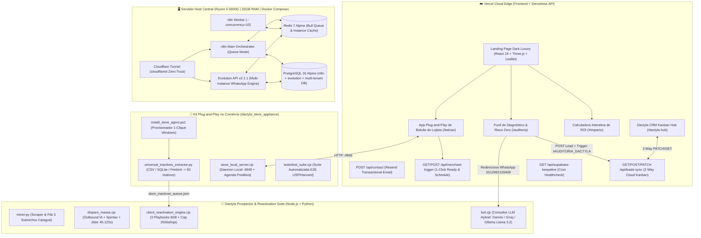

<div align="center">

# ⚡ DACTYLA CODE // ECOSSISTEMA B2B LOCAL-FIRST
### *Engenharia de Receita, Motor de Reativação Preditiva 48h &amp; Appliance Plug-and-Play para Comércios*

[](https://react.dev/)
[](https://vite.dev/)
[](https://tailwindcss.com/)
[](https://nodejs.org/)
[](https://www.python.org/)
[](https://www.docker.com/)
[](https://www.postgresql.org/)
[](https://www.dactylacode.com.br)

<p align="center">
  <b>Máquina B2B de Geração de Caixa Imediato ("Protocolo Caixa Primeiro em 48h") &amp; Engenharia de Software Proprietária.</b><br>
  Projetada sob rigor acadêmico e industrial (Padrão Poli-USP &amp; Harvard CS) para dominar a retenção de clientes e a automação comercial no Litoral Norte de São Paulo (Caraguatatuba, São Sebastião, Ubatuba e Ilhabela).
</p>

[🌐 Website Oficial](https://www.dactylacode.com.br) • [⚡ Simulador & Auditoria 48h](https://www.dactylacode.com.br/auditoria) • [🏪 App de Balcão do Lojista](https://www.dactylacode.com.br/balcao) • [📊 Dactyla CRM Hub](https://www.dactylacode.com.br/dactyla-hub)

---

</div>

## 🎯 Visão Executiva & Modelo Productized Service ("Protocolo Caixa Primeiro em 48h")

O monorepo da **Dactyla Code** une uma vitrine digital **Dark Luxury** de altíssima conversão (React 19 + Three.js WebGL + Leaflet Geo-Mapping) a uma infraestrutura **Local-First de Custo Marginal Zero** e um **Kit Plug-and-Play de Balcão (`dactyla_store_appliance/`)** para instalação em menos de 10 minutos nas dependências do comércio.

### Os 3 Subnichos-Alvo Homologados (Estudo Caraguatatuba/SP)

| Subnicho Local | Ticket Médio | Ciclo Ideal | Ponto de Equilíbrio (MRR R$ 130/mês) | Projeção (15 Recuperados/mês) |
| :--- | :---: | :---: | :--- | :---: |
| 🔧 **Oficinas / Centros Automotivos / Troca de Óleo** | `R$ 320,00` | `150 dias` | **1 carro recuperado/mês** já paga a mensalidade e deixa R$ 190 de lucro | **R$ 4.800/mês** |
| 🐾 **Pet Shops / Banho & Tosa / Clínicas Vet** | `R$ 85,00` | `30 dias` | **2 banhos recuperados/mês** já pagam o sistema (R$ 0/msg vs. R$ 0,50/msg SimplesVet) | **R$ 1.275/mês** |
| 💈 **Barbearias & Estética Masculina** | `R$ 75,00` | `21 dias` | **2 combos no caixa bruto** (ou 4 no lucro líquido) pagam toda a operação | **R$ 1.125/mês** |

---

## 📐 Topologia da Arquitetura Híbrida (Vercel Edge + Host 32GB + Store Appliance)



---

## 🗂️ Estrutura Completa do Monorepo

```text
Agencia de Tecnologia/
├── api/                                         # Vercel Serverless Functions (Node.js ESM)
│   ├── auth-crm.js                              # Autenticação HMAC-SHA256 com crypto.timingSafeEqual
│   ├── contact.js                               # Disparo transacional Resend (Motor 48h & Projetos Custom)
│   ├── leads-sync.js                            # API REST 2-Way (GET/POST/PATCH) para o Kanban Executivo
│   ├── merchant-trigger.js                      # Gatilho de Balcão (Serviço Pronto + Agendamento Preditivo)
│   └── supabase-keepalive.js                    # Cron Healthcheck & Keep-Alive da infraestrutura Serverless
│
├── dactyla_store_appliance/                     # Kit Plug-and-Play para Instalação nas Dependências do Comércio
│   ├── install_store_agent.ps1                  # Instalador 1-clique PowerShell para PC Windows da loja
│   ├── universal_inactives_extractor.py         # Extrator Universal (CSV/SQLite/Firebird) -> Lote 60 Inativos
│   ├── store_local_server.cjs                   # Micro-servidor local (:4848) de balcão e agenda preditiva
│   ├── README_INSTALACAO_COMERCIO.md            # Manual SOP de Implantação em 10 Minutos no Comércio
│   └── tests/
│       └── test_suite.cjs                       # Suíte Automatizada de Testes Unitários e de Integração
│
├── dactyla_prospector/                          # Motor B2B de Prospecção & Reativação de Clientes
│   ├── bot.cjs                                  # Assistente Conversacional LLM (Gemini/Groq/Ollama) + #AUDITORIA_DACTYLA
│   ├── client_reactivation_engine.cjs           # Produto B2B: Motor de Reativação com 3 Playbooks Spintax e Cap 20/dia
│   ├── disparo_massa.cjs                        # Outbound nos 3 nichos com Inbox Zero, Typing 4s e Jitter 45s-120s
│   ├── miner.py                                 # Minerador perpétuo focado em Oficinas, Pet Shops e Barbearias de Caraguá
│   ├── security_sanitizer.cjs                   # DevSecOps: Anti-Prompt Injection, Path Traversal e Validador JID
│   ├── sample_client_inactives.json             # Base de demonstração para Dry-Run dos 3 Playbooks de Reativação
│   └── package.json                             # Scripts operacionais (start, disparo, reactivate, test-ai)
│
├── docker/
│   └── postgres/
│       └── init.sql                             # Criação automática dos DBs (n8n, evolution) e tabelas multi-tenant
│
├── dactyla_engine/                              # Engenharia de PDV Offline-First & Big Data Regional
├── presenca-prime/                              # Micro-Framework Webhook Meta Cloud API (PHP 8.2+)
├── src/                                         # Aplicação Frontend React 19 + Vite 8 + Tailwind CSS v4
│   ├── components/
│   │   ├── HeroSection.jsx                      # Hero "Resgate os Clientes Sumidos em 48h" + Tamanduá 3D + Mapa
│   │   ├── ConcreteImpact.jsx                   # Calculadora Interativa de ROI por Subnicho + 3 Blocos de Impacto
│   │   ├── PricingSection.jsx                   # 3 Tiers (Motor 48h R$ 400 + R$ 130/mês em destaque)
│   │   ├── AuditoriaDactyla.jsx                 # Diagnóstico Interativo + Cálculo de Break-Even + Gatilho WhatsApp
│   │   ├── MerchantCounterApp.jsx               # Painel Operacional Plug-and-Play de Balcão do Lojista (/balcao)
│   │   ├── DactylaHub.jsx                       # CRM Kanban Cloud com Sincronização 2-Way Persistente
│   │   ├── BriefingModal.jsx                    # Captura rápida para o Protocolo Risco Zero
│   │   ├── EliteFooter.jsx                      # Rodapé com Integração Cal.com e WhatsApp Unificado (5512992109408)
│   │   └── MapComponent.jsx                     # Mapa Interativo Leaflet de Caraguatatuba
│   └── App.jsx                                  # Roteamento SPA + Code-Splitting com React.lazy()
│
├── docker-compose.yml                           # Stack Local-First (Postgres 16 + Redis 7 + Evolution v2 + n8n Queue + Cloudflared)
├── vercel.json                                  # Rewrites SPA e Cron Keep-Alive na Vercel
└── package.json                                 # Dependências, scripts de build e suíte de testes (`npm test`)
```

---

## 🚀 Guia de Implantação Rápida no Comércio (SOP em 10 Minutos)

```powershell
# 1. Rodar a Suíte Completa de Testes de Engenharia (12 asserções E2E)
npm test

# 2. Provisionar uma nova loja no PC do comércio (extrai 60 clientes inativos e valida Spintax)
powershell -ExecutionPolicy Bypass -File .\dactyla_store_appliance\install_store_agent.ps1 `
  -StoreName "Centro Automotivo Litoral" `
  -Niche "oficina"

# 3. Iniciar o disparo real de validação 48h (pareia QR Code no WhatsApp da loja)
node .\dactyla_prospector\client_reactivation_engine.cjs `
  --file .\dactyla_store_appliance\store_inactives_queue.json
```

---

<div align="center">
  <b>Dactyla Code © 2026 — Engenharia de Receita &amp; Automação B2B Local-First</b><br>
  <sub>Fundada por <b>Gabriel Hatakeyama</b> (CTO) &amp; <b>Matheus Vicente</b> (Diretor Criativo &amp; UX/UI) — Caraguatatuba, SP</sub>
</div>
